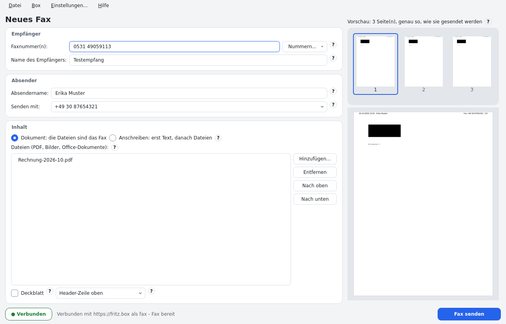
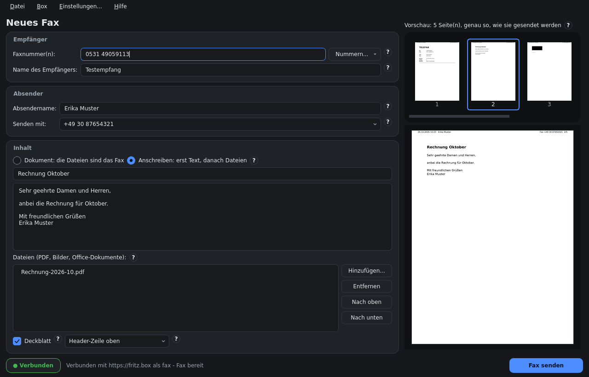

# fritzfax4u

**fritzfax** sends faxes through an AVM FRITZ!Box: a desktop app for Linux, Windows and macOS
(German and English) plus a command line.

[Deutsch](README.de.md)



fritzfax uses the same HTTP protocol as the box's own web interface. It needs **no CAPI over TCP**
(the reason Roger Router & co. stopped working) and no SIP account. See [docs/protocol.md](docs/protocol.md).

## Features

* **The document is the fax.** A one-page PDF is sent as a one-page fax: no forced cover letter.
  Optional letter text, cover sheet and header line.
* PDF, images (including multi-page TIFF) and office documents (with LibreOffice).
* A preview of exactly the pages that are sent. Remove single pages with Del or a right click.
* Several destination numbers, sent one after another; numbers may be written as `0531 49059113`,
  `0531-49059113` or `+49 (0)531 49059113`. The box's own numbers are shown as `+49 30 …`.
* Second-factor confirmation (button on the box, `*1<code>`, authenticator).
* **Every fax is checked with the box's own records**: final status, fax journal entry, the box's
  copy of the pages (compared bit for bit) and the call list. A local send log keeps when, to whom,
  which content and that result, with a PDF copy and a transmission report.
* If a call takes longer than expected, fritzfax waits for the box's own result instead of guessing.
* TLS certificate pinning; the password in the system keyring (only if you tick it), never in the
  settings file. No built-in box address, no telemetry.
* Light, dark or system theme; a (?) next to every setting explains it. Connects at start.
* Optional (off by default): an animation with fax sound and fanfare while a fax is sent.



Tested against a FRITZ!Box 7590 with FRITZ!OS 8.25: real faxes sent and received.

## Download

Ready-to-run packages are on the [releases page](https://github.com/c0decave/fritzfax4u/releases):

| System | Package | Start |
|---|---|---|
| Linux x86_64 (glibc ≥ 2.34; tested on Debian 12/13, Ubuntu 22.04/24.04, Fedora 42, Arch, Gentoo) | `fritzfax-<version>-linux-x86_64-libreoffice.tar.xz` (with LibreOffice) or `…-linux-x86_64.tar.xz` (PDF and images) | `./install.sh`, then `fritzfax-gui` |
| Windows x86_64 (built and tested on Windows Server 2022) | `fritzfax-<version>-windows-x86_64.zip` | unzip, `fritzfax-gui.exe` |
| macOS, Apple silicon (built and tested on macOS 14) | `fritzfax-<version>-macos-arm64.zip` | move `fritzfax.app` to Applications |

The Windows and macOS packages are not signed: Windows asks "Run anyway?", macOS wants a right
click → Open the first time (details in the README.txt of each package). Office documents on
Windows and macOS need an installed LibreOffice; PDF and images always work.

Every package has a `.sha256` file. Check a package with `fritzfax selftest` (or `--gui`).

### Linux

```sh
tar xf fritzfax-<version>-linux-x86_64-libreoffice.tar.xz
cd fritzfax-<version>-linux-x86_64-libreoffice && ./install.sh   # ~/.local, menu entry, runs the selftest
./uninstall.sh                                                    # remove it again (settings and log stay)
```

`install.sh --prefix DIR` installs elsewhere. It never replaces a `fritzfax` command it did not install.

### From source

```sh
pip install --user .            # needs Python 3.11+, PySide6, Pillow
pip install --user '.[keyring]' # optional: the password in the system keyring
fritzfax-gui                    # GUI
fritzfax --help                 # command line
```

## The FRITZ!Box side

* Telefonie → Telefoniegeräte: the fax function ("Faxfunktion") must be set up with a fax number.
* Use a box user with the permission for telephony ("Sprachnachrichten, Faxnachrichten, …").
* Dial **with area code**: without it (and for international numbers) the box asks for a
  confirmation on the box itself.

## Command line

```sh
fritzfax trust                                   # pin the box certificate (again after the box renewed it)
fritzfax set-password                            # the password in the keyring (or FRITZFAX_PASSWORD)
fritzfax info
fritzfax send --to "0531 49059113" letter.pdf    # the PDF pages are the fax
fritzfax send --to "030 1234567, 040 7654321" --text "Hello" --subject "Request" --cover appendix.pdf
fritzfax send --to 0301234567 --dry-run --out preview/ letter.pdf
fritzfax journal [--download ID --out fax.pdf] [--delete ID]
fritzfax boxconfig [--identifier X --header Y --email a@b.de --no-email-forward]
```

Settings and send log: `~/.config/fritzfax` and `~/.local/share/fritzfax` on Linux,
`%APPDATA%\fritzfax` and `%LOCALAPPDATA%\fritzfax` on Windows, `~/Library/Application Support/fritzfax` on macOS.

## Development

Tests and the Linux build run in disposable podman containers; Windows and macOS are built by
[.github/workflows/release.yml](.github/workflows/release.yml).

```sh
tools/dev.sh build        # once (needs network)
tools/dev.sh pytest       # unit, integration (fake FRITZ!Box), GUI (offscreen), offline
FRITZFAX_URL=https://<box address> FRITZFAX_USER=… FRITZFAX_PASSWORD=… tools/dev.sh live
                          # read-only checks against a real box (+ FRITZFAX_LIVE_SEND=<nr> sends ONE fax)
./dist.sh                 # Linux packages (privacy scan first, everything offline in podman)
tools/dist_test.sh --gui  # the packages on Debian, Ubuntu, Fedora, Arch, Gentoo and under X11
```

## License and trademarks

MIT, see [LICENSE](LICENSE). The bundled LibreOffice, Qt and Python libraries keep their own
licenses (LICENSES/ in the packages). FRITZ!Box is a trademark of AVM; fritzfax is not affiliated
with AVM. The outline of Germany in the animation comes from Natural Earth (public domain); its
eagle is a free design, not the federal coat of arms.
